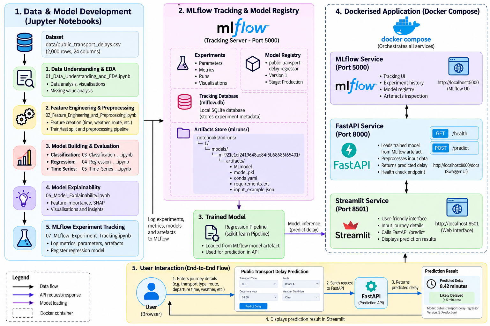
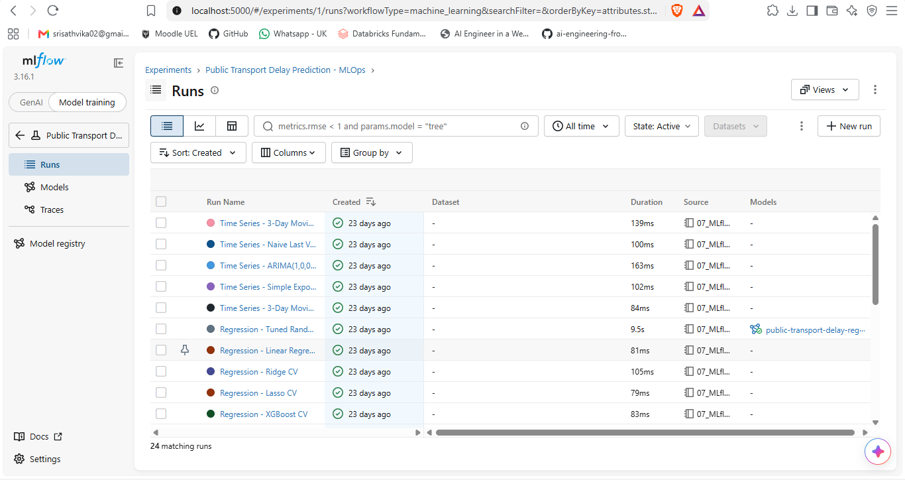
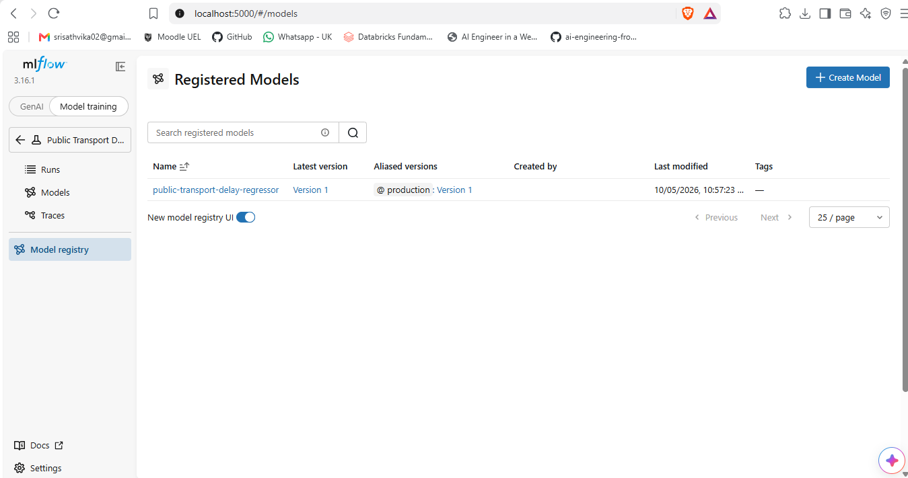
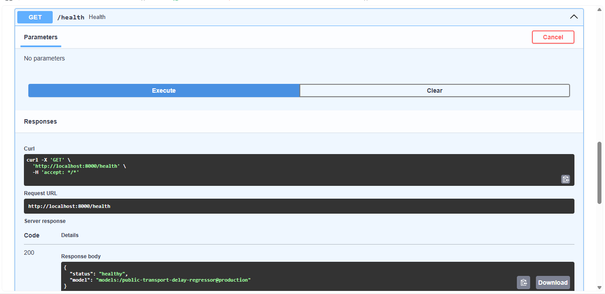
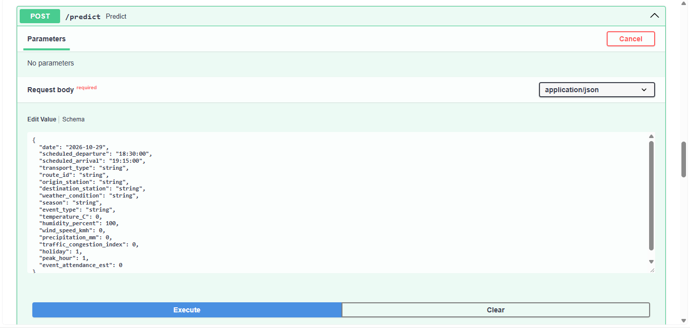
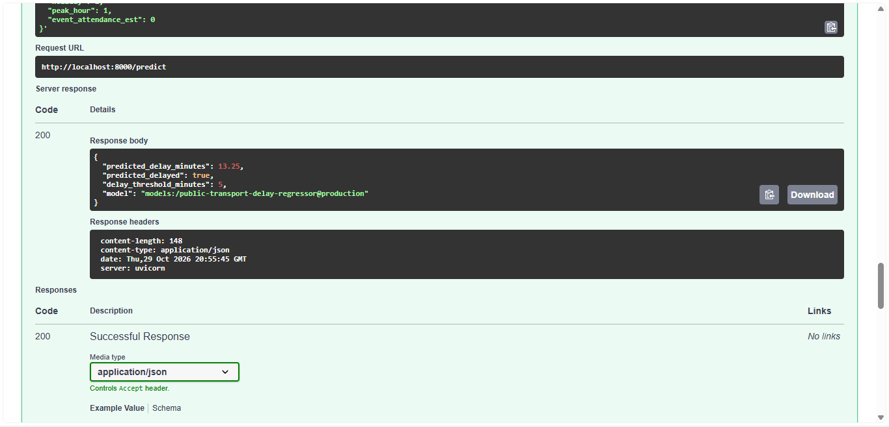
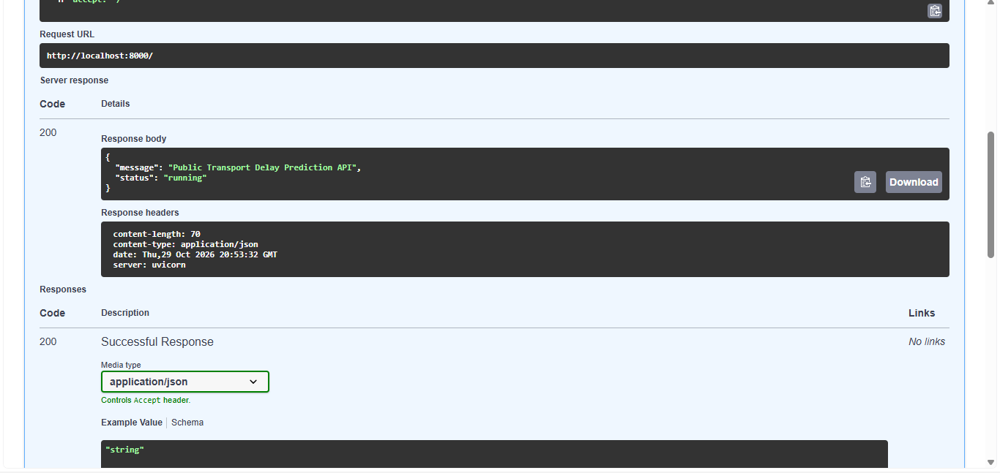
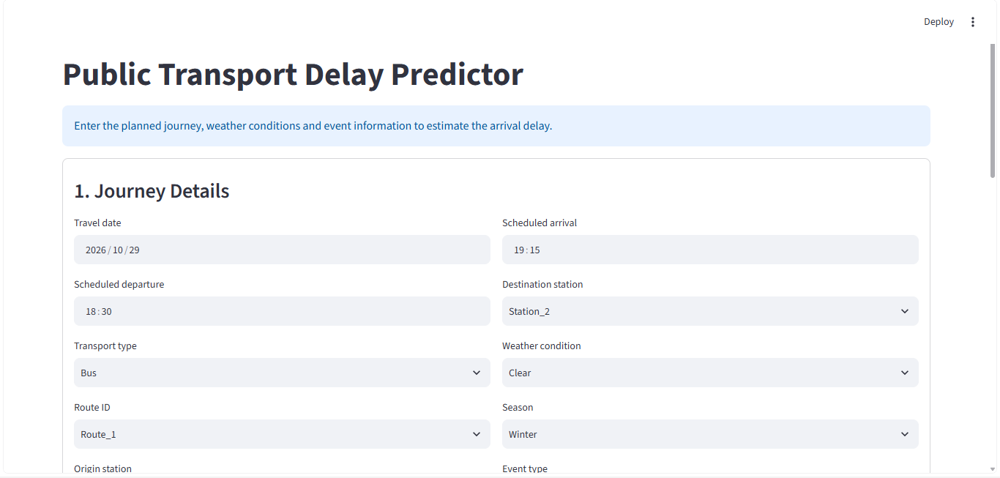
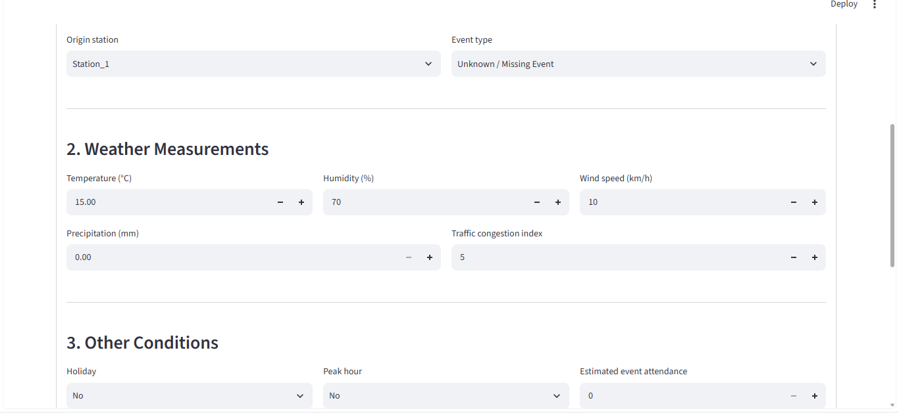
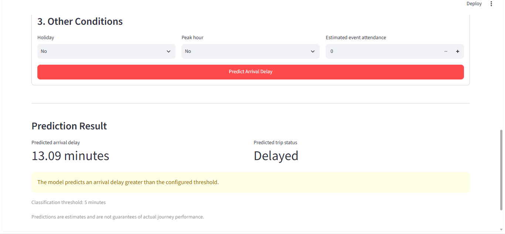

# Public Transport Delay Prediction Using Machine Learning and MLOps

**An end-to-end machine learning project for predicting public transport arrival delays, evaluating predictive models, explaining model behaviour, tracking experiments, and serving predictions through a containerised web application.**

## Table of Contents

1. [Project Overview](#1-project-overview)
2. [Problem Statement](#2-problem-statement)
3. [Project Objectives](#3-project-objectives)
4. [Dataset Description](#4-dataset-description)
5. [Technology Stack](#5-technology-stack)
6. [System Architecture](#6-system-architecture)
7. [Machine Learning Workflow](#7-machine-learning-workflow)
8. [Notebook-by-Notebook Explanation](#8-notebook-by-notebook-explanation)
9. [Model Evaluation and Results](#9-model-evaluation-and-results)
10. [Model Explainability](#10-model-explainability)
11. [MLOps and Experiment Tracking](#11-mlops-and-experiment-tracking)
12. [API Development](#12-api-development)
13. [Streamlit Application](#13-streamlit-application)
14. [Docker and Containerisation](#14-docker-and-containerisation)
15. [Project Structure](#15-project-structure)
16. [Installation and Setup](#16-installation-and-setup)
17. [Using the Application](#17-using-the-application)
18. [Challenges and Lessons Learned](#18-challenges-and-lessons-learned)
19. [Limitations](#19-limitations)
20. [Future Improvements](#20-future-improvements)
21. [Key Skills Demonstrated](#21-key-skills-demonstrated)

---

## 1. Project Overview

Public transport delays can affect passenger journeys, service reliability, connections, and daily travel planning. Understanding when delays occur and estimating their duration can help transport operators and passengers make more informed decisions.

This project investigates the use of machine learning to predict public transport arrival delays using historical journey information, transport characteristics, weather conditions, traffic congestion, scheduled times, and other engineered features.

The project implements a complete machine learning workflow, including data exploration, feature engineering, model development, evaluation, time-series analysis, model explainability, experiment tracking, API development, and containerisation.

Unlike a project that stops after training a model in a Jupyter Notebook, this implementation also exposes predictions through a FastAPI backend and an interactive Streamlit application. Docker Compose brings the main services together so that they can run locally as one application.

The project contains three main modelling tasks:

- **Classification:** Investigating whether a journey will be delayed.
- **Regression:** Estimating the actual arrival delay in minutes.
- **Time-series forecasting:** Investigating patterns in aggregated delay observations over time.

The regression model is carried forward into the prediction application. Its current performance is limited, and that limitation is documented rather than hidden.

## 2. Problem Statement

Public transport delays are influenced by multiple factors, including scheduled departure times, routes, transport types, traffic congestion, weather, and special events. The relationships between these variables and actual arrival delays may be nonlinear and difficult to model using simple rules.

The problem addressed by this project is:

**Can machine learning techniques use available journey and contextual features to estimate arrival delay duration and identify patterns in public transport delays?**

The project investigates this question through supervised learning and time-series analysis. It also examines how a trained model can be integrated into a software application and managed through an MLOps workflow.

An important distinction is made between predicting a delay before a journey and analysing a delay after it has occurred. Variables containing realised delay information must not be used as predictors in a genuine pre-trip scenario because that information would not yet be available.

## 3. Project Objectives

The main objectives are:

1. **Explore the data:** Understand the dataset's structure, distributions, missing values, and relationships between features.
2. **Prepare features:** Transform numerical, categorical, date, and time information into model-ready inputs.
3. **Develop classification models:** Compare algorithms for identifying delayed journeys and evaluate their limitations.
4. **Develop regression models:** Predict arrival delay duration and compare candidate models against a simple baseline.
5. **Investigate time-series patterns:** Preserve chronological order and evaluate a forecasting baseline.
6. **Explain model behaviour:** Use feature importance, permutation importance, and SHAP to investigate model predictions.
7. **Track experiments:** Use MLflow to record model parameters, metrics, and artefacts.
8. **Build a prediction API:** Serve model predictions through FastAPI.
9. **Develop a user interface:** Provide an interactive prediction interface using Streamlit.
10. **Containerise the application:** Use Docker and Docker Compose to run the services together.

## 4. Dataset Description

The project dataset is stored at:

`data/public_transport_delays.csv`

The dataset used in the modelling workflow contains **2,000 observations and 24 original columns**.

Dataset Link: https://www.kaggle.com/datasets/khushikyad001/public-transport-delays-with-weather-and-events/data

The columns represent different aspects of a public transport journey, including scheduled journey information, route and station characteristics, environmental conditions, and realised delay information.

### Feature categories

| Category | Examples of information |
|---|---|
| Journey information | Transport type, route, origin, destination |
| Schedule information | Scheduled departure and arrival times |
| Calendar information | Date, day of the week, month, weekend indicators |
| Environmental conditions | Weather, temperature, humidity, wind, precipitation |
| Operational context | Traffic congestion, holidays, peak hours |
| Event information | Event type and estimated attendance |
| Outcome variables | Actual departure and arrival delays |

These categories describe the information used in the project; not every original field is necessarily passed directly to every model.

### Prediction targets

The project defines separate targets for the different modelling tasks.

**Classification target: `delayed`**

- `0` — On time
- `1` — Delayed

**Regression target: `actual_arrival_delay_min`**

The regression model estimates the numerical arrival delay in minutes.

**Time-series target**

The time-series workflow examines delay measurements aggregated over time to investigate temporal patterns and forecasting performance.

### Data leakage prevention

Data leakage occurs when a model uses information that would not legitimately be available at prediction time, or otherwise receives information that gives it an unfair advantage.

The project excludes the realised delay fields `actual_departure_delay_min` and `actual_arrival_delay_min` from predictive features where they would leak the outcome.

The classification task revealed an additional target-definition limitation: the `delayed` label exactly matches whether `actual_arrival_delay_min` exceeds five minutes. Consequently, a pre-trip classifier cannot simply use the realised arrival delay to predict the label. The classifier is treated as a diagnostic experiment rather than a production-ready prediction model.

## 5. Technology Stack

| Technology | Purpose |
|---|---|
| Python | Main programming language |
| Pandas and NumPy | Data manipulation and numerical operations |
| scikit-learn | Preprocessing, pipelines, model training and evaluation |
| Matplotlib and Seaborn | Data visualisation and evaluation plots |
| SHAP | Model explanation and feature contribution analysis |
| Jupyter Notebook | Exploratory analysis and modelling experiments |
| MLflow | Experiment tracking and model registry |
| FastAPI | REST API for model predictions |
| Streamlit | Interactive web interface |
| Docker | Containerising application services |
| Docker Compose | Running the services together |
| Git and GitHub | Version control and project collaboration |

## 6. System Architecture

The application separates model development, experiment tracking, prediction serving, and the user interface into distinct components.




### How the components work together

**1. Data and modelling layer**

The dataset is explored, cleaned, transformed, and used to train and evaluate models in the notebooks.

**2. Experiment-tracking layer**

MLflow records completed experiments, evaluation metrics, parameters, and model artefacts. It also provides an interface for inspecting experiment history and registered models.

**3. Model-serving layer**

FastAPI exposes an HTTP endpoint that accepts journey features and returns a prediction generated by the regression pipeline.

**4. User-interface layer**

Streamlit provides the interface through which a user supplies journey details and requests a prediction.

**5. Containerisation layer**

Docker Compose coordinates the API, UI, and MLflow services. Within Docker, the Streamlit container communicates with FastAPI using the internal service address rather than `localhost`.

## 7. Machine Learning Workflow

The project follows a structured machine learning lifecycle.

### Stage 1: Data understanding

The first stage investigates the dataset before modelling begins. It examines the available columns, feature distributions, missing values, target distributions, and relationships between variables.

This stage helps establish what information is available and identifies potential problems that could affect model development.

### Stage 2: Feature engineering and preprocessing

Raw data often requires transformation before it can be used effectively by machine learning algorithms.

The preprocessing workflow includes:

- Separating targets from predictive features.
- Excluding identifiers and inappropriate post-outcome information.
- Preparing numerical and categorical columns.
- Imputing missing values where required.
- Scaling numerical features where appropriate.
- Applying one-hot encoding to categorical variables.
- Extracting useful calendar and schedule features.
- Creating cyclical encodings for departure time.

For example, departure hour can be represented using sine and cosine transformations. This allows the model to represent the fact that 23:00 and 00:00 are temporally close, rather than treating them as distant numerical values.

Preprocessing is integrated into model pipelines to help ensure that training and inference use consistent transformations.

### Stage 3: Classification

The classification task investigates whether a journey is delayed.

Several algorithms are compared, including baseline, linear, tree-based, distance-based, and probabilistic approaches. Evaluation includes measures such as precision, recall, F1-score, balanced accuracy, ROC-AUC, and precision-recall AUC.

The purpose is to compare model behaviour rather than select a model based only on accuracy.

### Stage 4: Regression

The regression task estimates `actual_arrival_delay_min`.

A mean-prediction baseline is established before more complex models are evaluated. Candidate regression algorithms are compared using five-fold cross-validation, and the Random Forest model is subsequently tuned.

The selected pipeline is evaluated on an untouched test set using:

- **MAE:** Mean Absolute Error.
- **RMSE:** Root Mean Squared Error.
- **R²:** Coefficient of determination.

The final results show that the tuned Random Forest does not outperform the simple mean baseline on the test set. This is an important finding and a key area for future improvement.

### Stage 5: Time-series analysis

The time-series workflow preserves chronological ordering and investigates aggregated delay behaviour over time.

A three-day moving average is used as a simple forecasting baseline. This provides a reference point for assessing whether a temporal forecasting approach offers useful predictive information.

The aggregated time-series evaluation is distinct from the per-journey regression evaluation, so their error values should not be compared directly.

### Stage 6: Model explainability

Feature importance, permutation importance, and SHAP explanations are used to investigate the behaviour of the regression model.

These methods help identify which features contribute to the model's predictions, both globally and for individual observations. They do not establish that those features cause transport delays.

### Stage 7: Experiment tracking and serving

MLflow records completed experiments and their associated results. The selected regression model is made available to the prediction service, which exposes it through FastAPI. Streamlit provides the interactive front end, and Docker Compose runs the application services together.

## 8. Notebook-by-Notebook Explanation

The project is organised into seven notebooks, with each notebook addressing a specific stage of the workflow.

### Notebook 1 — Data Understanding and EDA

File: `01_Data_Understanding_and_EDA.ipynb`

**Purpose:** Understand the dataset before building models.

This notebook explores the dataset's dimensions, columns, data types, missing values, distributions, and relationships between variables. It helps identify potentially useful features and provides an initial understanding of the delay prediction problem.

**Output:** An understanding of the available data and the questions that the modelling workflow should investigate.

### Notebook 2 — Feature Engineering and Preprocessing

File: `02_Feature Engineering_and_Preprocessing.ipynb`

**Purpose:** Convert raw journey data into appropriate model inputs.

This notebook defines the classification and regression targets, prepares the features, constructs train/test splits, and applies preprocessing decisions. It also addresses potential leakage from realised delay measurements.

**Output:** Prepared feature sets and consistent train/test splits for the modelling notebooks.

### Notebook 3 — Classification Model Building and Evaluation

File: `03_Classification_Model_Building_and_Evaluation.ipynb`

**Purpose:** Investigate models that classify journeys as delayed or on time.

The notebook compares multiple classification algorithms using a consistent preprocessing approach. It evaluates the models with classification metrics and examines their behaviour on the test set.

The results reveal a limitation: the Random Forest diagnostic classifier predicts all 400 test observations as delayed. Although some metrics appear high because the positive class is common, balanced accuracy is 0.50 and test ROC-AUC is approximately 0.4818.

**Output:** Classification comparisons, evaluation metrics, and a documented target-construction limitation.

### Notebook 4 — Regression Model Building and Evaluation

File: `04_Regression_Model_Building_and_Evaluation.ipynb`

**Purpose:** Estimate arrival delay duration in minutes.

The notebook establishes a mean baseline, compares candidate regression algorithms using cross-validation, tunes a Random Forest regressor, evaluates it on the untouched test set, and analyses prediction residuals.

It saves the final regression pipeline and evaluation artefacts for use in subsequent stages.

**Output:** The selected regression pipeline, cross-validation results, test metrics, prediction results, and residual analysis.

### Notebook 5 — Time-Series Analysis and Forecasting

File: `05_Time_Series_Analysis_and_Forecasting.ipynb`

**Purpose:** Investigate whether temporal patterns in aggregated delays can support forecasting.

This notebook preserves the time order of observations, examines the delay series, evaluates forecasting approaches, and uses a three-day moving average as a baseline.

**Output:** Time-series validation results, test results, and forecast artefacts.

### Notebook 6 — Model Explainability

File: `06_Model_Explainability.ipynb`

**Purpose:** Understand how the selected regression model generates predictions.

The notebook applies four complementary explanation approaches:

- Built-in Random Forest feature importance.
- Permutation feature importance.
- SHAP global feature importance and summary analysis.
- SHAP local explanations for individual predictions.

It saves numerical results and visualisations to the project's explainability results directory.

**Output:** Feature-importance tables, SHAP explanations, and figures that help interpret model behaviour.

### Notebook 7 — MLflow Experiment Tracking

File: `07_MLflow_Experiment_Tracking.ipynb`

**Purpose:** Track the results already produced by the modelling notebooks.

This notebook records completed classification, regression, and time-series experiments in MLflow. It logs relevant parameters, validation and test metrics, model artefacts, and explainability results.

The notebook focuses on experiment tracking rather than independently retraining models or inventing new performance results.

**Output:** MLflow experiment history and artefacts that make model comparisons and experiment provenance easier to inspect.

## 9. Model Evaluation and Results

Model evaluation is essential because a model that successfully runs is not necessarily a model that predicts accurately.

The current evaluation results are summarised below.

### Regression results

The selected regression model is a tuned Random Forest regressor.

| Test-set metric | Tuned Random Forest | Mean baseline |
|---|---:|---:|
| MAE | 7.7501 minutes | 7.7030 minutes |
| RMSE | 9.2602 minutes | 9.1901 minutes |
| R² | -0.0170 | -0.0017 |

The tuned Random Forest's five-fold cross-validation RMSE is approximately 9.3056 minutes, compared with approximately 9.3145 minutes for the mean baseline.

However, the final test-set results show that the tuned Random Forest does not outperform the baseline.

#### What do the metrics mean?

**Mean Absolute Error (MAE)** measures the average absolute difference between predicted and actual delay values. The model's MAE of approximately 7.75 minutes means that its predictions are, on average, about 7.75 minutes away from the actual target values in the test set.

**Root Mean Squared Error (RMSE)** penalises larger errors more heavily than MAE. The test RMSE is approximately 9.26 minutes.

**R²** measures predictive performance relative to a mean-based reference. A negative test R² indicates that the model performs worse under this metric than predicting the test target mean.

#### Regression conclusion

The current regression model is technically integrated into the application, but its predictive performance is not yet satisfactory. The simple baseline performs slightly better on the test set.

The results are retained honestly rather than using post-outcome information to artificially improve performance. Further investigation is needed to establish whether better features, additional data, alternative targets, or different modelling strategies can improve predictive accuracy.

### Classification findings

The classification experiment exposes a different limitation.

The `delayed` label exactly matches whether the actual arrival delay exceeds five minutes. Because realised delay information is unavailable in a strict pre-trip scenario, it cannot legitimately be used as an input feature.

In the diagnostic test evaluation, the Random Forest predicts all 400 observations as delayed. Its balanced accuracy is 0.50 and its ROC-AUC is approximately 0.4818.

This means that apparently strong precision, recall, or F1 values alone would give an incomplete picture of performance.

**Conclusion:** The current classifier is a diagnostic experiment, not a reliable production-ready pre-trip classifier.

### Time-series findings

The time-series workflow uses a three-day moving average as a forecasting baseline on aggregated delay observations.

Its reported daily aggregate MAE is approximately 0.96 on the aggregate target's scale. This is not a per-journey delay error measured in minutes and should not be compared directly with the regression metrics above.

The short historical series also limits how confidently forecasting performance can be generalised. Additional chronological observations and validation periods would be useful in future work.

## 10. Model Explainability

A model's predictions are more useful to analyse when its behaviour can be investigated.

The project uses several explainability methods for the regression pipeline.

### Built-in feature importance

Random Forest feature importance provides an initial ranking of features used by the fitted model. It helps identify which inputs the model relies on most heavily.

### Permutation importance

Permutation importance evaluates how model performance changes when a feature is shuffled. A substantial decrease in performance after shuffling can indicate that the model relies on that feature.

### SHAP global explanations

SHAP global analysis examines how features contribute to predictions across observations. It provides another perspective on feature influence and can complement the model's built-in importance measures.

### SHAP local explanations

Local SHAP explanations investigate an individual prediction and show how different feature contributions move the prediction relative to the model's reference value.

### Important interpretation note

Feature importance and SHAP values explain model behaviour; they do not prove causal relationships. Because the regression model currently performs poorly relative to its baseline, its explanations should also be interpreted cautiously.

## 11. MLOps and Experiment Tracking

MLOps brings software engineering practices into the machine learning lifecycle. It helps make model experiments easier to track, reproduce, deploy, and maintain.

This project uses MLflow for experiment tracking and model management.

### Experiment tracking

MLflow records information associated with completed experiments, including:

- Model and experiment names.
- Relevant hyperparameters.
- Validation and test metrics.
- Evaluation result files.
- Saved model artefacts.
- Explainability outputs and experiment metadata.

This makes it possible to compare model experiments without relying solely on notebook outputs.




### Model registry

The current local MLflow environment contains the registered model:

`public-transport-delay-regressor`

The registered version is version 1, with the `production` alias assigned in the local registry.



The regression pipeline is also stored as a model artefact. The API currently loads the verified MLflow logged-model artefact from its Linux path inside the Docker image, which avoids the Windows file-path issue encountered during containerisation.

### Why this matters

The project separates model development from model serving. The notebooks produce and evaluate models, MLflow records the experiments, and FastAPI provides the prediction interface.

This is an important step beyond notebook-only machine learning because it introduces model provenance, experiment management, and an application interface.

### Reproducibility considerations

The local MLflow database, registered-model metadata, and model artefacts have different roles. The database stores tracking and registry information, while the artefacts contain model files and experiment outputs.

The local `mlflow.db` is excluded from Git. A fresh clone therefore needs an appropriately provisioned tracking database if the original local experiment history and registry are to be reproduced. The required model artefacts must also exist at the paths expected by the API.

For a portable public deployment, the model artefacts and tracking configuration should be provisioned explicitly rather than relying on a developer's machine-specific paths.

## 12. API Development

FastAPI exposes the regression model through HTTP endpoints.

### Health endpoint

`GET /health`

This endpoint confirms that the API is running and reports its health status.




### Prediction endpoint

`POST /predict`

This endpoint accepts the journey information required by the application's prediction pipeline and returns a predicted arrival delay.

The response includes the predicted delay in minutes, a delayed/on-time indicator derived from the configured threshold, and model identification information.

The threshold-based indicator is a rule applied to the regression prediction; it should not be interpreted as evidence that a separately validated classification model is being used.






### Interactive API documentation

FastAPI automatically provides an interactive Swagger UI at:

`http://localhost:8000/docs`



The documentation displays the actual request schema and allows users to test the endpoint.

The API separates model inference from the user interface, which makes it possible to test and maintain the prediction service independently.

## 13. Streamlit Application

Streamlit provides a simple interactive interface for the prediction workflow.

The interface allows a user to supply the supported journey inputs and request a prediction without directly writing an API request.

The application communicates with the FastAPI backend through the `API_URL` environment variable. In Docker Compose, the configured endpoint is:

`http://api:8000/predict`

Here, `api` is the Docker Compose service name. The address is used for communication between containers; it is not the address a browser uses to access the API from the host computer.

The Streamlit application is available locally at:

`http://localhost:8501`

This separation allows the interface and backend to run as different services.





## 14. Docker and Containerisation

Docker packages application components into containers, helping them run in a consistent environment. Docker Compose defines how the main services are configured and connected.

The project contains two main Docker configuration files.

### Dockerfile.api

`Dockerfile.api` defines the API image. It uses Python 3.10, installs the project dependencies, copies the API source and required model artefacts into the image, and starts the FastAPI application using Uvicorn.

### docker-compose.yml

`docker-compose.yml` coordinates three services:

| Service | Responsibility | Local port |
|---|---|---:|
| `mlflow` | Experiment tracking and model registry UI | 5000 |
| `api` | Model inference through FastAPI | 8000 |
| `ui` | Interactive Streamlit interface | 8501 |

The MLflow service uses a local SQLite backend in the current development setup. The API depends on MLflow being healthy, while the UI communicates with the API through the Docker network.

### Why containerisation is useful

- It keeps the API, UI, and tracking service logically separate.
- It defines the dependencies and startup configuration for the application.
- It makes the local application easier to start and stop consistently.
- It reduces reliance on manually launching each service in a separate terminal.
- It provides a foundation for deployment to a suitable container-hosting environment.

Containerisation does not automatically guarantee reproducibility. Model artefacts, dependency versions, configuration, and persistent tracking data still need to be managed correctly.

## 15. Project Structure

```text
Public Transport Delays/
│
├── api/
│   └── app.py
│
├── artifacts/
│   ├── models/
│   │   ├── best_regression_pipeline.joblib
│   │   └── best_time_series_model.joblib
│   └── splits/
|
|─── docs/
|
│
├── data/
│   └── public_transport_delays.csv
│
├── notebooks/
│   ├── 01_Data_Understanding_and_EDA.ipynb
│   ├── 02_Feature Engineering_and_Preprocessing.ipynb
│   ├── 03_Classification_Model_Building_and_Evaluation.ipynb
│   ├── 04_Regression_Model_Building_and_Evaluation.ipynb
│   ├── 05_Time_Series_Analysis_and_Forecasting.ipynb
│   ├── 06_Model_Explainability.ipynb
│   ├── 07_MLflow_Experiment_Tracking.ipynb
│   └── mlruns/
│
├── results/
│   ├── classification/
│   ├── explainability/
│   ├── mlflow/
│   ├── regression/
│   └── time_series/
│
├── ui/
│   └── streamlit_app.py
│
├── .gitignore
├── Dockerfile.api
├── docker-compose.yml
└── requirements.txt
```

The `artifacts` directory contains saved models and data splits. The `results` directory contains evaluation tables, predictions, and explainability outputs. The MLflow tracking directory stores model and experiment artefacts used by the local application.

## 16. Installation and Setup

### Prerequisites

Install the following tools:

- Git
- Docker Desktop
- A terminal such as PowerShell

Python and Jupyter are also useful if you intend to inspect or rerun the notebooks.

### Step 1: Clone the repository

```bash
git clone https://github.com/srisathvika/Public-Transport-Delay-Prediction.git
cd Public-Transport-Delay-Prediction
```

### Step 2: Check the required files

Before starting the services, confirm that the repository contains the required model artefacts and configuration files.

The API image expects the MLflow logged-model artefact directory to be available under:

`notebooks/mlruns/1/models/m-921c1cf2419648ae84f5b68686f65401/artifacts/`

The local tracking database is not committed to Git. A fresh clone will therefore not automatically contain the existing local MLflow tracking history and registry metadata.

If the artefacts or registry configuration are missing, provision them according to the project's deployment setup before expecting the full local MLflow history to appear.

### Step 3: Start Docker Desktop

Ensure Docker Desktop is running.

Check the Docker installation:

```bash
docker --version
docker compose version
```

### Step 4: Build and start the services

From the project root, run:

```bash
docker compose up -d --build
```

This builds the API image where necessary and starts the services in the background.

### Step 5: Verify the services

```bash
docker compose ps
```

Check the logs if a service fails:

```bash
docker compose logs --tail=50 api
docker compose logs --tail=50 ui
docker compose logs --tail=50 mlflow
```

### Step 6: Access the application

| Component | URL |
|---|---|
| Streamlit application | http://localhost:8501 |
| FastAPI Swagger UI | http://localhost:8000/docs |
| FastAPI health endpoint | http://localhost:8000/health |
| MLflow interface | http://localhost:5000 |

### Stop the services

```bash
docker compose down
```

This stops and removes the containers created by Compose. Avoid using `docker compose down -v` unless you deliberately intend to remove associated persistent volumes.

## 17. Using the Application

1. Start the Docker services.
2. Open the Streamlit interface at `http://localhost:8501`.
3. Enter the journey information requested by the application.
4. Submit the prediction request.
5. Review the predicted delay duration and the delayed/on-time indicator.
6. If you need to inspect the API request and response, open `http://localhost:8000/docs`.
7. To inspect MLflow experiment history in the existing local environment, open `http://localhost:5000`.

The prediction is generated by the regression pipeline. Its results should be interpreted in the context of the model's current test-set performance and limitations.

## 18. Challenges and Lessons Learned

### Avoiding data leakage

The classification target is defined using the realised arrival delay. Excluding the realised delay fields from predictors prevents the model from using information that would not be available before the journey.

This also revealed that the classification problem needs a carefully designed target and suitable pre-trip features to become operationally useful.

### Evaluating against a baseline

The regression experiments demonstrate why a more complex model is not automatically a better model. Although the tuned Random Forest slightly improves cross-validation RMSE compared with the mean baseline, it does not outperform that baseline on the final test set.

### Keeping preprocessing consistent

Combining preprocessing and estimators in a pipeline helps ensure that the transformations used during training are also applied during prediction.

### Managing model artefacts and dependency versions

The model was saved using scikit-learn 1.4.0. Aligning the API container with that version reduces the compatibility risk associated with loading a persisted scikit-learn model under a different version.

### Resolving container networking

The Streamlit container cannot use `127.0.0.1:8000` to reach FastAPI in a different container. Docker Compose service-name networking allows Streamlit to communicate with the API at `http://api:8000/predict`.

### Handling platform-specific model paths

The original MLflow metadata included a Windows file URI that could not be resolved as a normal Linux path inside Docker. The current API therefore loads the verified model artefact through its container path. A more portable deployment should explicitly manage model storage and tracking configuration.

## 19. Limitations

The project is an educational machine learning and MLOps prototype, not a validated transport operations system.

The main limitations are:

- The current regression model does not outperform the mean baseline on the final test set.
- The negative test R² indicates weak predictive performance relative to a mean-based reference.
- The classification experiment has a target-construction limitation and is not suitable for claiming reliable pre-trip delay classification.
- The available historical time series is short, limiting the strength of forecasting conclusions.
- The current Docker setup depends on expected local model artefact paths and MLflow configuration.
- The application has not been established as a production-grade, monitored service.
- Model explainability results describe learned associations and model behaviour, not causation.

These limitations identify concrete areas for further development and should be considered before any operational use.

## 20. Future Improvements

### Model performance

- Investigate the regression target distribution and baseline performance.
- Examine additional features and obtain more representative transport observations.
- Evaluate alternative models and compare them consistently against baselines.
- Improve the classification target definition and evaluate it on a suitable pre-trip prediction scenario.
- Expand the time-series history and use chronological validation.

### MLOps

- Make model artefact storage independent of machine-specific paths.
- Provision the model registry and tracking backend reproducibly.
- Add automated tests for preprocessing and prediction.
- Introduce continuous integration for testing and build validation.
- Add monitoring for prediction quality and potential model drift.
- Define a versioned process for updating and promoting models.

### Application and deployment

- Deploy the interface and API to suitable hosting services.
- Add automated API integration tests.
- Improve input validation and user-facing error handling.
- Add application logging and operational health monitoring.
- Document model assumptions and expected input ranges.

### Documentation and reproducibility

- Include screenshots of the application and MLflow interface.
- Record exact dependency versions.
- Provide a reproducible setup for a fresh clone.
- Add a clear process for obtaining or provisioning required model artefacts.

## 21. Key Skills Demonstrated

This project demonstrates practical experience with:

- Python-based data analysis and feature engineering.
- Supervised machine learning and model evaluation.
- Classification and regression metrics.
- Time-series analysis and forecasting baselines.
- Scikit-learn preprocessing pipelines.
- Hyperparameter tuning and cross-validation.
- Model explainability using feature importance and SHAP.
- MLflow experiment tracking and model registry concepts.
- REST API development with FastAPI.
- Interactive application development with Streamlit.
- Docker image creation and Docker Compose orchestration.
- Git-based version control and project documentation.
- Debugging dependency, artefact-path, and container-networking issues.

## Conclusion

The Public Transport Delay Prediction project demonstrates the journey from data exploration and model experimentation to an application that serves predictions through an API and interactive interface.

Its main contribution is the integration of machine learning, experiment tracking, explainability, API development, and containerisation into one project.

The current predictive results also demonstrate the importance of honest model evaluation: a working application is not sufficient evidence of a useful predictive model. Improving generalisation, establishing stronger baselines, and making artefact management fully reproducible are the next priorities.

**Project repository:** https://github.com/srisathvika/Public-Transport-Delay-Prediction